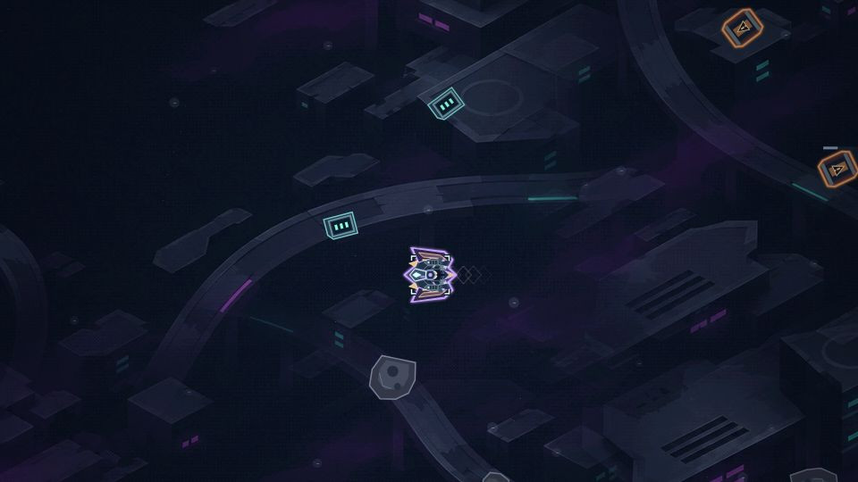

# Reactor Rogue

A free browser-based space survival game. Choose a ship, build your arsenal and fight through a fleet of enemies across neon sectors.

**[Play Reactor Rogue](https://jambig1.github.io/reactor-rogue/)**

## The game

- Twelve playable ships with different starting weapons, passives and movement abilities.
- Six sectors with distinct scenery, hazards and boss encounters.
- Weapons, evolutions, defensive equipment and passive items to combine into different builds.
- Every evolution adds a distinct signature attack, from missile carriers and cutting rings to fusion lattices and collapsing vortices.
- An Arsenal discovery guide with illustrated equipment, saved discoveries and tracked evolution recipes.
- Ship unlock challenges, credits, contracts and permanent upgrade tools.
- Optional distress signals, interactive sector features and an alien merchant.
- Three scheduled sector bosses, a clear ending and optional endless continuation.
- Graphics, audio and accessibility options, including reduced motion.

The game is in active development. Balance, content and presentation may change between updates.

Choose **Play**, select your ship, then choose a sector and launch. Your last ship and sector are remembered. Buy licences and permanent upgrades in the Hangar.

## Controls

| Action | Keyboard and mouse | Phone and tablet |
| --- | --- | --- |
| Move | WASD or arrow keys | Drag to steer |
| Ship ability | Shift or middle-click | Tap the ability button |
| Pause | Esc or P | Tap the pause button |
| Upgrade | Click a choice, or use its number key | Tap a choice |

Weapons fire automatically by default. Aiming, firing and movement options are available in Settings.

## Progress and saves

Progress is stored in the current browser on the current device. Use **Settings → Profiles & saves** to create local profiles, download a backup or import a backup as a separate profile.

Backups include banked progression, not an unfinished run. Online accounts and automatic cross-device cloud saves are not available yet.

## Bugs and suggestions

Use the feedback form on the [game website](https://jambig1.github.io/reactor-rogue/home.html#feedback). No GitHub account, game account or email address is required. Reports go to a private feedback inbox rather than a public issue list.

Include what happened, what you expected and your device/browser. Please leave out passwords, private save files and personal information.

## Running the project locally

The game uses plain HTML, CSS and JavaScript, with no package installation or build step. Serve this repository with a local static web server and open `home.html` for the website or `index.html?play=1` for the game.

Game art and the font are versioned WebP/WOFF files served beside `index.html`. Optional GPU effects use Three.js 0.187.0, bundled in `vendor/` under its MIT licence; without WebGL2 the game uses the classic 2D renderer. The hosted site also has an offline cache; feedback submission needs an internet connection.

## Project documentation

- [Maintainer notes](DEVELOPMENT-HANDOVER.md): file layout, saves, testing and release checks.
- [Roadmap](ROADMAP.md): implemented systems and future ideas.
- [Recent changes](CHANGELOG.md): a concise release summary.
- [Cloud save setup](CLOUD-SETUP.md): the optional account integration and its current limits.
- [Balance measurements](BALANCE-NOTES.md) and [pacing measurements](PACING-NOTES.md): historical test methods and results.

Run variety includes shuffled fleet operations, regular recovery windows and optional Relay Circuits. Complete a circuit to choose one run-only field protocol for close-range, long-range, cold-target or siege damage. Protocols replace one another and do not use equipment slots.

Current playable version: **0.72.0**.

## Font attribution

The game uses Exo 2. Its SIL Open Font License is included in [FONT-LICENSE-Exo2.txt](FONT-LICENSE-Exo2.txt).
